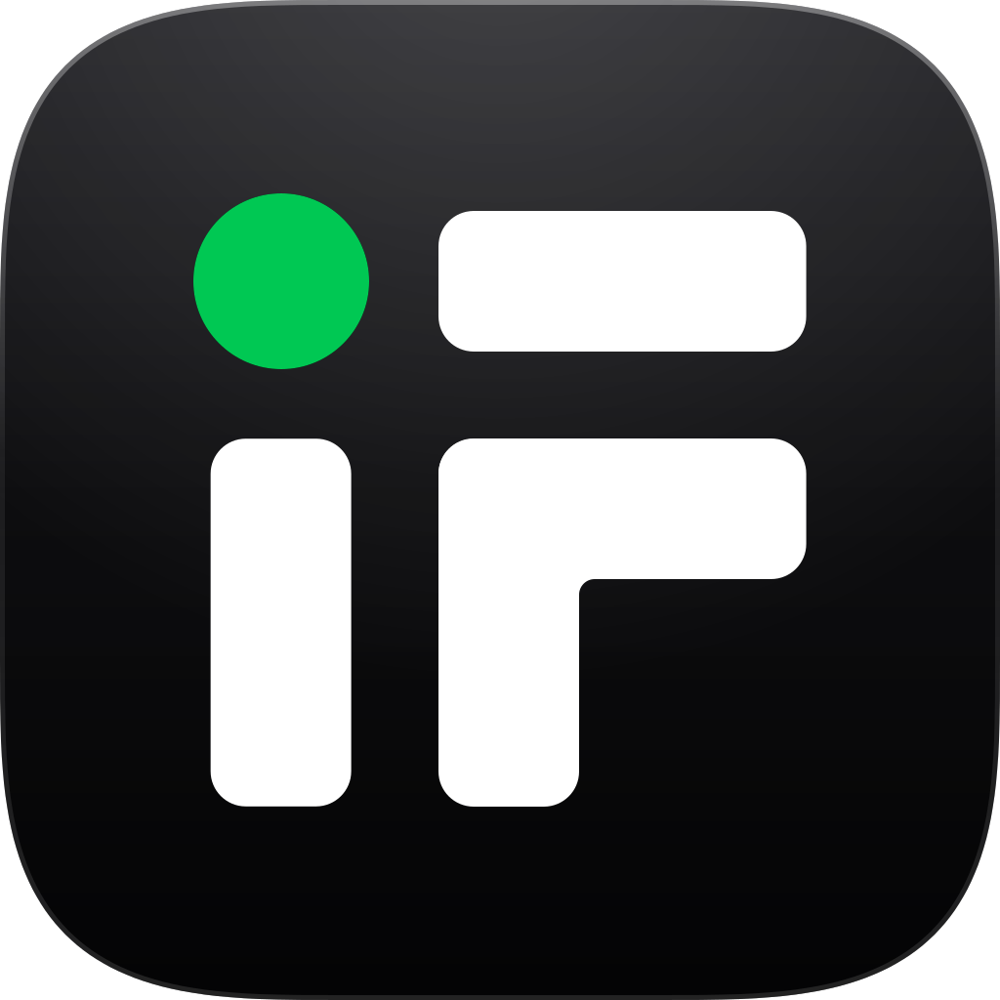

<p align="center">
  
</p>

<h1 align="center">istfin MCP: Borsa Istanbul (BIST) data for AI assistants</h1>

<p align="center">
  Licensed BIST market data in Claude, ChatGPT, Cursor, VS Code and any MCP client.<br>
  Prices, OHLCV bars, financial statements, ratios, KAP filings, indexes and backtests.
</p>

<p align="center">
  <a href="https://api.istfin.com/mcp">Website</a> ·
  <a href="https://api.istfin.com/docs/mcp">Docs</a> ·
  <a href="https://api.istfin.com/fiyatlandirma">Pricing</a> ·
  <a href="#türkçe">Türkçe</a>
</p>

<p align="center">
  <a href="https://glama.ai/mcp/connectors/com.istfin/mcp"></a>
</p>

---

istfin is a licensed Borsa Istanbul data distributor. The istfin MCP server is a hosted remote server: there is nothing to install or run. Add the URL to your client, sign in (or pass an API key) and ask questions like *"What did THYAO close at over the last 20 days?"*.

| | |
| --- | --- |
| **Server URL** | `https://mcp.istfin.com/mcp` |
| **Transport** | Streamable HTTP |
| **Auth** | OAuth 2.1 with PKCE and dynamic client registration, or `Authorization: Bearer istfin_live_...` |
| **Registry name** | `com.istfin/mcp` ([Official MCP Registry](https://registry.modelcontextprotocol.io/v0/servers?search=com.istfin)) |
| **Coverage** | 600+ BIST equities, BIST indexes, KAP disclosures |
| **Freshness** | Live prices on the Live plan, 15 minute delayed on the Basic plan |
| **Requires** | An istfin API subscription ([pricing](https://api.istfin.com/fiyatlandirma)) |

## Connect

### Claude.ai and Claude Desktop (OAuth, no key needed)

1. **Settings > Connectors > Add custom connector**
2. Name `istfin`, remote MCP server URL `https://mcp.istfin.com/mcp`
3. Click **Connect**, sign in to istfin and approve.

### ChatGPT (OAuth)

1. **Settings > Apps & Connectors > Advanced settings**, enable **Developer mode**
2. **Create**: name `istfin`, MCP server URL `https://mcp.istfin.com/mcp`, authentication **OAuth**
3. Sign in to istfin on the page that opens and approve.

### API key clients

Create a key at [api.istfin.com/hesap/anahtarlar](https://api.istfin.com/hesap/anahtarlar) and replace `istfin_live_...` below.

<details open>
<summary><b>Claude Code</b></summary>

```bash
claude mcp add --transport http istfin https://mcp.istfin.com/mcp \
  --header "Authorization: Bearer istfin_live_..."
```
</details>

<details>
<summary><b>Cursor</b> (<code>.cursor/mcp.json</code> or <code>~/.cursor/mcp.json</code>)</summary>

```json
{
  "mcpServers": {
    "istfin": {
      "url": "https://mcp.istfin.com/mcp",
      "headers": { "Authorization": "Bearer istfin_live_..." }
    }
  }
}
```
</details>

<details>
<summary><b>VS Code</b> (<code>.vscode/mcp.json</code>)</summary>

```json
{
  "servers": {
    "istfin": {
      "type": "http",
      "url": "https://mcp.istfin.com/mcp",
      "headers": { "Authorization": "Bearer istfin_live_..." }
    }
  }
}
```
</details>

<details>
<summary><b>Windsurf</b> (<code>~/.codeium/windsurf/mcp_config.json</code>)</summary>

```json
{
  "mcpServers": {
    "istfin": {
      "serverUrl": "https://mcp.istfin.com/mcp",
      "headers": { "Authorization": "Bearer istfin_live_..." }
    }
  }
}
```
</details>

<details>
<summary><b>Gemini CLI</b> (<code>~/.gemini/settings.json</code>)</summary>

```json
{
  "mcpServers": {
    "istfin": {
      "httpUrl": "https://mcp.istfin.com/mcp",
      "headers": { "Authorization": "Bearer istfin_live_..." }
    }
  }
}
```
</details>

<details>
<summary><b>OpenCode</b> (<code>opencode.json</code>)</summary>

```json
{
  "$schema": "https://opencode.ai/config.json",
  "mcp": {
    "istfin": {
      "type": "remote",
      "url": "https://mcp.istfin.com/mcp",
      "headers": { "Authorization": "Bearer istfin_live_..." },
      "enabled": true
    }
  }
}
```
</details>

<details>
<summary><b>Codex</b> (<code>~/.codex/config.toml</code>)</summary>

```toml
[mcp_servers.istfin]
url = "https://mcp.istfin.com/mcp"
http_headers = { "Authorization" = "Bearer istfin_live_..." }
```
</details>

<details>
<summary><b>Any other MCP client</b></summary>

Any client that supports Streamable HTTP works. Most accept this shape:

```json
{
  "mcpServers": {
    "istfin": {
      "url": "https://mcp.istfin.com/mcp",
      "headers": { "Authorization": "Bearer istfin_live_..." }
    }
  }
}
```
</details>

**Agent shortcut:** in Claude Code, Cursor, Windsurf, OpenCode or Codex, paste this into the chat and the agent writes the config for you:

```text
set up https://api.istfin.com/SKILL.md  (my API key: istfin_live_...)
```

To check it works, ask: *"THYAO fiyatı ne?"* (What is the THYAO price?). The client should call `get_quotes`.

## Tools

22 tools: 20 read-only, 2 that write to your own istfin portfolio. The server never places orders and never moves money or shares.

| Tool | Scope | What it does |
| --- | --- | --- |
| `search_symbols` | `market:read` | Find a stock by name or ticker |
| `get_symbol` | `market:read` | Identity, sector and index membership of one stock |
| `get_quotes` | `market:read` | Prices for one or more stocks (live or 15 min delayed) |
| `get_movers` | `market:read` | Top gainers, losers and volume leaders |
| `get_bars` | `market:read` | OHLCV bars, 1 minute to monthly |
| `get_fundamentals` | `fundamentals:read` | P/E, P/B, market cap and other summary ratios |
| `get_financial_statement` | `fundamentals:read` | Balance sheet, income statement, cash flow |
| `get_ratio_series` | `fundamentals:read` | Historical series of a ratio |
| `search_news` | `news:read` | Search KAP (Public Disclosure Platform) filings |
| `get_news` | `news:read` | Full text of one filing |
| `list_indexes` | `market:read` | BIST indexes |
| `get_index` | `market:read` | Index value and constituents |
| `list_sectors` | `market:read` | Sectors and their members |
| `list_indicators` | `market:read` | Technical indicators usable in strategies |
| `describe_indicator` | `market:read` | Inputs, outputs and an example for one indicator |
| `run_strategy` | `market:read` | Backtest a strategy on one or more stocks |
| `list_portfolios` | `portfolio:read` | Your saved portfolios |
| `get_portfolio` | `portfolio:read` | Positions, cost basis and P&L |
| `get_portfolio_performance` | `portfolio:read` | Return, drawdown and benchmark comparison |
| `analyze_holdings` | `portfolio:read` | Analyze a transaction list without saving it |
| `create_portfolio` | `portfolio:write` | Create an empty portfolio |
| `add_portfolio_transactions` | `portfolio:write` | Add buys, sells and dividends to a portfolio |

Read tools carry `readOnlyHint`. Every response has structured data (`structuredContent`), a short Turkish summary, `source` and `asOf`. KAP filing text is marked as untrusted content so clients do not treat it as instructions.

The server also exposes two resources (`istfin://intervals`, `istfin://scopes`) and two prompts (`piyasa-brifingi`, `hisse-analizi`).

## Example prompts

- *Prepare today's BIST summary: XU100, top 5 gainers and losers, notable KAP filings.*
- *Pull THYAO's last 30 daily closes and summarize the trend and volatility.*
- *List ASELS's last 10 KAP filings and explain the important ones.*
- *Compare THYAO and PGSUS on P/E, P/B and EBITDA margin.*
- *Rank XU030 constituents by weight and give the daily change of the top 10.*
- *Backtest an RSI(14) < 30 buy, > 70 sell strategy on GARAN over the last two years.*

## Quotas and errors

Only `tools/call` counts against your quota. Most tools cost 1 request, `get_bars` costs 2 and `run_strategy` costs 10 per stock; see the [docs](https://api.istfin.com/docs/mcp) for the full table. MCP and the [REST API](https://api.istfin.com/docs) share the same daily and per-minute limits.

Without credentials the server returns `401` with `WWW-Authenticate: Bearer resource_metadata="..."`, which OAuth-capable clients use to start sign-in. Quota errors come back as `isError: true` with `structuredContent.code` set to `QUOTA_EXCEEDED` or `RATE_LIMITED`.

## REST API

The same data is available over REST with the same key:

```bash
curl https://api.istfin.com/v1/quotes?symbols=THYAO \
  -H "Authorization: Bearer istfin_live_..."
```

Guides for [Python](https://api.istfin.com/entegrasyonlar/python), [Excel](https://api.istfin.com/entegrasyonlar/excel) and [Google Sheets](https://api.istfin.com/entegrasyonlar/google-sheets).

## Data license

Data is distributed under a Borsa Istanbul license. Personal use and your own team's internal tools are allowed. Redistributing data to third parties is subject to the Borsa Istanbul license; see the [terms of use](https://api.istfin.com/yasal).

---

## Türkçe

**istfin MCP**, Borsa İstanbul lisanslı verisini Claude, ChatGPT, Cursor, VS Code ve diğer MCP istemcilerine bağlayan uzak MCP sunucusudur. Kurulum yok: adresi ekleyin, istfin hesabınızla giriş yapın, sonra *"THYAO son 20 günlük kapanışları ne?"* diye sorun.

- **Adres:** `https://mcp.istfin.com/mcp` (Streamable HTTP)
- **Kimlik doğrulama:** Claude.ai, Claude Desktop ve ChatGPT'de OAuth ile istfin hesabınızdan giriş; diğer istemcilerde `Authorization: Bearer istfin_live_...` başlığı
- **Veri:** 600'den fazla BIST hissesi için fiyat (Canlı planda canlı, Temel planda 15 dk gecikmeli), 1 dakikadan aylığa OHLCV barları, bilanço, gelir tablosu, nakit akışı, F/K, PD/DD gibi oranlar, KAP bildirimleri, endeksler, sektörler ve backtest
- **Araçlar:** 22 araç, 20 okuma ve 2 portföy yazma. Sunucu emir iletmez, para ya da hisse hareketi yapmaz.
- **Kota:** REST API ile ortak. Çoğu araç 1 istek, `get_bars` 2, `run_strategy` hisse başına 10 istek sayılır.

### Bağlanma

**Claude.ai / Claude Desktop:** Ayarlar > Bağlayıcılar > Özel bağlayıcı ekle. Ad `istfin`, adres `https://mcp.istfin.com/mcp`. Bağlan deyip istfin sayfasında izin verin.

**ChatGPT:** Ayarlar > Uygulamalar ve bağlayıcılar > Gelişmiş ayarlar > Geliştirici modu. Oluştur: ad `istfin`, adres `https://mcp.istfin.com/mcp`, kimlik doğrulama OAuth.

**Claude Code, Cursor, VS Code, Windsurf, Gemini CLI, OpenCode, Codex:** [panelden](https://api.istfin.com/hesap/anahtarlar) anahtar üretin ve yukarıdaki yapılandırmalardan istemcinize uyanı kullanın. Ya da ajanınızın sohbetine şunu yazın:

```text
set up https://api.istfin.com/SKILL.md  (API anahtarım: istfin_live_...)
```

### Örnek istekler

- *istfin ile bugünün BIST özetini hazırla: XU100, en çok yükselen/düşen 5 hisse, öne çıkan KAP bildirimleri*
- *THYAO son 30 günlük kapanışlarını çek, trendi ve volatiliteyi özetle*
- *ASELS'in son 10 KAP bildirimini listele ve önemli olanları açıkla*
- *THYAO ve PGSUS'u F/K, PD/DD, FAVÖK marjı ile karşılaştır*
- *Bankacılık sektöründeki hisseleri son çeyrek net kâr büyümesine göre sırala*

Dokümantasyon: [api.istfin.com/docs/mcp](https://api.istfin.com/docs/mcp) · Fiyatlar: [api.istfin.com/fiyatlandirma](https://api.istfin.com/fiyatlandirma) · Destek: destek@istfin.com

---

This repository holds documentation and client configuration examples only. The server itself is hosted by istfin and is not open source.
